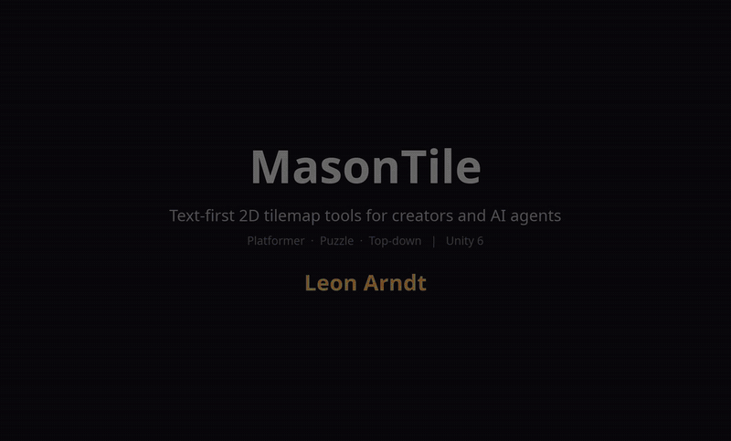

# MasonTile

**Text-first tilemap editing for Unity, built for creators and LLM agents, plus a benchmark for agent tools.**



This repository holds two Unity packages:

| Package | What it does |
|---|---|
| [**MasonTile**](Packages/com.leonarndt.masontile/README.md) `com.leonarndt.masontile` | Read and write Tilemaps as character grids. Undoable fill, line, flood-fill and cave commands, a Text View window, two playable sample games, and eight Unity AI Assistant `[AgentTool]`s that use the same command layer as the UI. |
| [**Unity Agent Bench**](Packages/com.leonarndt.agentbench/README.md) `com.leonarndt.agentbench` | Measures how well an agent gets creator tasks done with your AI Assistant tools. Tier 1 replays reference solutions as EditMode tests; tier 2 runs Claude Code headless against the same tasks and compares runs to catch regressions. |

MasonTile ships a 13-task suite for Agent Bench. It compiles only when both packages are installed.

```
##################
#gggg.....~~~~...#
#gggg.....~~~~.c.#      '#' wall   'g' grass   '~' water
#.....ffff.......#      'f' floor  'c' coin    '*' spikes
#.....ffff..###..#      '.' empty
#..c..........*..#
##################
```

## Install

Requires Unity 6000.4 or newer. In Package Manager choose **Install package from git URL** and enter one or both:

```
https://github.com/leon-arndt/MasonTile.git?path=/Packages/com.leonarndt.masontile#masontile-v0.2.0
https://github.com/leon-arndt/MasonTile.git?path=/Packages/com.leonarndt.agentbench#agentbench-v0.1.0
```

MasonTile's agent tools need `com.unity.ai.assistant` 2.x and switch on when it is installed. Everything else works
without it. Agent Bench needs AI Assistant, and its harness also uses `com.unity.pipeline`. See each package's README
for details.

## Releases

Each package is versioned and tagged separately: `masontile-vX.Y.Z` and `agentbench-vX.Y.Z`. Changes are listed in
the [MasonTile changelog](Packages/com.leonarndt.masontile/CHANGELOG.md) and the
[Agent Bench changelog](Packages/com.leonarndt.agentbench/CHANGELOG.md).

## License

[MIT](LICENSE) © Leon Arndt
